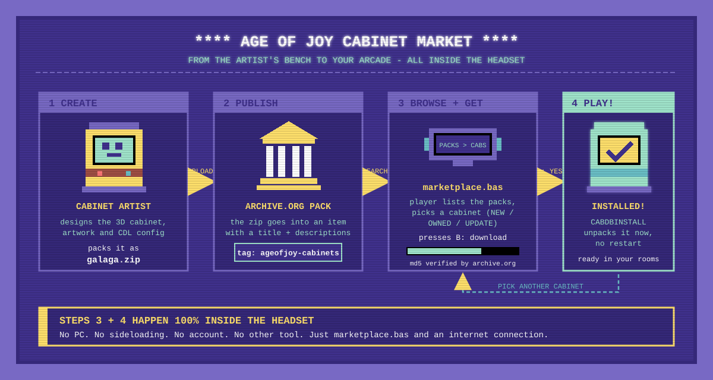

# Sharing Cabinets with archive.org

This guide explains how to publish your AGE of Joy cabinets on [archive.org](https://archive.org) (the Internet Archive) so other players can download them.

You upload your cabinet `.zip` files to an archive.org **item**, then share the item's **identifier** (or its URL) with the community. AGE of Joy reads the item's public file list and downloads the cabinets. Players don't need an archive.org account, a login or an API key.

---

## 1. Before you start

- **Account:** you need a free archive.org account to upload. Sign up at archive.org and verify your email address. Players who download your cabinets don't need an account.
- **Everything is public.** Items on archive.org are visible to anyone, indexed by search engines, and close to permanent. You can delete files later, but the identifier stays reserved.
- **Only upload what you have the right to share.** Your own 3D models, configuration and artwork are fine, and so is material with a free licence.
  - **Never put ROMs inside the cabinet zips.**
  - Be careful with artwork that shows copyrighted characters.
  - archive.org removes items after copyright complaints. A removed ("darked") item disappears for everyone, including every player who uses your identifier.

---

## 2. Naming rules

AGE of Joy finds your cabinets and descriptions by **name**, so please follow these rules.

| What | Rule | Example |
|---|---|---|
| **Item identifier** | Lowercase letters, digits and `-`. Chosen once when you upload and **can't be changed** later. Must be unique on all of archive.org. | `ageofjoy-curif-pack-1` |
| **Cabinet file** | One `.zip` per cabinet. Name it after the cabinet using lowercase letters, digits, `-` and `_`, with no spaces. | `galaga.zip` |
| **Cabinet description** *(optional)* | A custom metadata field **named after the cabinet**, whose value is the description. | field `galaga` = `The standard Galaga cabinet` |

About the description field name:
- AGE of Joy accepts the cabinet name **with or without** the `.zip` suffix, so `galaga` and `galaga.zip` both work.
- **Use the name without `.zip`.** archive.org is strict about metadata field names, and a field name containing a dot may be rejected.
- Matching ignores upper and lower case, but keeping everything lowercase avoids surprises.

An item can hold as many cabinets as you like. One item is effectively a **cabinet pack**.

---

## 3. Uploading with the website

1. Log in to archive.org and click **Upload** (top right), or go to `https://archive.org/upload`.
2. Drag in your cabinet zips, for example `galaga.zip` and `dkong.zip`.
3. Fill in the form:
   - **Page URL:** this becomes the **identifier**, for example `ageofjoy-curif-pack-1`. Choose it carefully, because you can't change it later.
   - **Title:** a readable name, for example `AGE of Joy Cabinet Pack 1`.
   - **Description:** a short description of the whole pack.
   - **Subject tags:** `ageofjoy`, `cabinet` and **`ageofjoy-cabinets`**. The last one makes your pack show up in the game's pack search (see "Getting listed").
   - **Media type:** *Software*.
   - **License:** optional; pick one if you want to.
4. Open **Add additional metadata** and add **one row per cabinet**. Each row is a field name and a value:

   | Field name | Value |
   |---|---|
   | `galaga` | The standard Galaga cabinet |
   | `dkong` | Donkey Kong, original Nintendo cabinet |
   | `defender` | Williams Defender |

5. Click **Upload and Create Your Item**.
6. **Wait for processing.** archive.org processes new and changed items in the background. This usually takes a few minutes, but sometimes takes hours. Files can be missing until processing finishes.

---

## 4. Updating a pack later

From your item's page (`https://archive.org/details/<identifier>`), click **Edit item**. From there you can:

- **Add files:** upload new zips.
- **Replace a cabinet:** upload a file with the **same name**, and the new file replaces the old one.
- **Delete files:** remove cabinets you no longer want to share.
- **Edit metadata:** add, change or remove the per-cabinet description fields.

Players keep using the same identifier, so updates reach them automatically.

---

## 5. Uploading with the command line (optional)

If you have many cabinets, the official `internetarchive` tool is faster than the website.

```bash
pip install internetarchive
ia configure                     # asks for your archive.org email and password, once

# create the item and upload the cabinets
ia upload ageofjoy-curif-pack-1 *.zip \
   --metadata="mediatype:software" \
   --metadata="title:AGE of Joy Cabinet Pack 1" \
   --metadata="subject:ageofjoy" \
   --metadata="subject:cabinet" \
   --metadata="subject:ageofjoy-cabinets" \
   --metadata="galaga:The standard Galaga cabinet" \
   --metadata="dkong:Donkey Kong, original Nintendo cabinet"

# add or replace a cabinet later
ia upload ageofjoy-curif-pack-1 frogger.zip

# add or change a description
ia metadata ageofjoy-curif-pack-1 --modify="frogger:Konami Frogger"

# remove a cabinet
ia delete ageofjoy-curif-pack-1 frogger.zip
```

---

## 6. Sharing your pack

Give the community **either** of these. Both refer to the same pack, and AGE of Joy accepts both:

- the identifier: `ageofjoy-curif-pack-1`
- the URL: `https://archive.org/details/ageofjoy-curif-pack-1`

### Getting listed

Add the subject tag **`ageofjoy-cabinets`** to your item and the game finds it by itself, with no registration. Players list all tagged packs with `IASEARCH("")`.

- For an existing item: **Edit item → Subject tags**, or `ia metadata <identifier> --append-list="subject:ageofjoy-cabinets"`.
- archive.org's search index updates minutes to hours after the change, so a new pack may take a while to appear.
- Check it in a browser: `https://archive.org/advancedsearch.php?q=subject%3A%22ageofjoy-cabinets%22&fl[]=identifier&output=json`

---

## 7. Checking your pack

Open this address in any browser:

```
https://archive.org/metadata/<identifier>
```

You'll see the exact data AGE of Joy reads. Check that:

- every cabinet `.zip` appears in the `"files"` list;
- your description fields (`"galaga": "..."`) appear inside the `"metadata"` section;
- there is **no** `"pending_tasks"` entry; if there is one, archive.org is still processing the item, so wait and check again;
- there is **no** `"is_dark": true`; if there is, the item has been taken down and isn't available.

---

## 8. Example: `cabinet-pack-1-1`

This is a real test pack. Its metadata is at `https://archive.org/metadata/cabinet-pack-1-1`.

**Cabinet files:**

| File | Size (bytes) |
|---|---|
| `defender.zip` | 2773566 |
| `dkong.zip` | 1607422 |
| `frogger.zip` | 2427103 |
| `galaga.zip` | 2688890 |
| `galaxian.zip` | 2365422 |

**Description fields** (in the `"metadata"` section):

```json
"galaga": "the standard galaga blah blah",
"defender": "the defender"
```

The other files in the item are added by archive.org itself and ignored by AGE of Joy: `cabinet-pack-1-1_files.xml`, `cabinet-pack-1-1_meta.xml`, `cabinet-pack-1-1_meta.sqlite` and `cabinet-pack-1-1_archive.torrent`.

> Tip: this example item's **Title** is `curif`. A descriptive title, such as `AGE of Joy Cabinet Pack 1`, makes the pack easier to recognise on archive.org.

---

## 9. What AGE of Joy reads (developer reference)

> The AGEBasic functions `IALOAD`, `IASTATUS`, `IAINFO`, `IACABS`, `IACABINFO` and `IADOWNLOAD` / `IADOWNLOADSTATUS` / `IADOWNLOADPROGRESS` implement the rules below. `IAFILES`, `IAFILEINFO` and `IAFILEDOWNLOAD*` do the same for any file type (saved in `downloads/`). They are documented in `docs/agebasic_prompt.md` ("Internet Archive & Downloads"), and `AGEBasicTests/config/internetarchive.bas` is a working example. Code: `InternetArchive.cs` (parsing), `DownloadManager.cs` (network, md5), `basic/functions/internetarchive.cs`.

- **Item data:** `GET https://archive.org/metadata/<identifier>`. This public JSON needs no key and no login. If the user gives a URL like `https://archive.org/details/<identifier>`, the identifier is the last part of the path.
- **Pack search (`IASEARCH` / `IAPACKS`):** `GET https://archive.org/advancedsearch.php?q=<query>&fl[]=identifier&rows=1000&sort[]=publicdate desc&output=json`. The default query is `subject:"ageofjoy-cabinets"`. The answer is `{"response":{"numFound":N,"docs":[{"identifier":"..."}]}}`; no match is `numFound: 0` with empty `docs`, not an error. The search index lags uploads.
- **Download:** `https://archive.org/download/<identifier>/<file name>`.
- **Which files are cabinets:** entries in `files` whose name ends in `.zip` (case-insensitive) and whose `source` is `original`. The game ignores:
  - archive.org's own files: `<identifier>_files.xml`, `_meta.xml`, `_meta.sqlite` and `_archive.torrent`;
  - every file with `source: "derivative"`, such as the files archive.org generates automatically.
- **Cabinet description:** the `metadata` field named after the cabinet. The game tries `galaga` first, then `galaga.zip`, ignoring case.
- **Values can be a string or a list:** archive.org returns a single value as a string and repeated values as an array (this applies to `subject`, `description` and custom fields). A reader must accept both.
- **Numbers come as strings:** `size` and `mtime` are strings and must be parsed.
- **Integrity:** every file has an `md5` (and `sha1`). Downloads are verified against it, and a cabinet that is already downloaded with the same md5 doesn't need to be downloaded again.
- **Item not ready or not available:**
  - `pending_tasks` present means the item is still processing.
  - `is_dark: true` with no `files` or `metadata` means the item was taken down.
  - An unknown identifier returns an empty object `{}`.

### How the game applies these rules

- The metadata and the files are requested with `UnityWebRequest`, which follows the redirect from `archive.org/download/...` to the storage server.
- A download is written to `<name>.zip.part` and renamed to `<name>.zip` only after the md5 matches. A failed or corrupt download leaves no file behind.
- Every verified download is recorded in `configuration/internetarchive_md5.txt`. A cabinet that is present (unpacked in `cabinetsdb` or still waiting in `cabinets`) with that md5 is not downloaded again.
- A downloaded zip in `cabinets` is unpacked the next time the app starts or a room loads; the loader deletes the zip afterwards. A script can install it right away, without restarting, with `CABDBINSTALL` / `CABDBINSTALLSTATUS`.

---

## 10. Cabinet Market: find, download and install from the headset (`marketplace.bas`)

`marketplace.bas` (in `agebasicdev/`) is a standalone AGEBasic program that lets a player do the whole trip inside the headset: find packs, pick a cabinet, download it from archive.org and install it, with no PC, no sideloading and no restart. It is the player-facing side of everything above: a pack only shows up in it if its item has the subject tag `ageofjoy-cabinets` (see "Getting listed").



### What the player sees

A C64-style full-screen program (palette from `SETCOLORSPACE "c64"`, charset from the cabinet's `system-skin`), with a breadcrumb `1 PACKS > 2 CABINETS > 3 INSTALL`.

| Step | Screen | What happens |
|---|---|---|
| Search | `ARCHIVE.ORG` box with a spinner | `IASEARCH("")` lists the tagged packs, then every pack is read with `IALOAD` ("READING PACK n OF N"). |
| 1 Packs | Pack list + info panel | Pack title, number of cabinets (`n CABS`) and description. A pack that isn't `READY` (`PROCESSING`, `DARK`, error) is shown in red and can't be opened. Empty packs can't be opened either. |
| 2 Cabinets | Cabinet list + info panel | Name, size, state and description. Tags: `NEW` (not downloaded), `OWNED` (same md5 already present), `UPDATE` (a different version is present). |
| 3 Install | Download progress bar, then `INSTALL?` box | `IADOWNLOAD` + `IADOWNLOADPROGRESS`; when finished the player confirms the install. |
| Result | `SUCCESS` / `ERROR` / `CANCELLED` box | B returns to the cabinet list to pick another one. |

Controls: **Up/Down** move, **Left/Right** change page, **B** open the pack / download the cabinet / confirm / continue / retry, **A** back to the packs / refuse the install, **Y** leave (`SHUTDOWN`).

### Flow and the functions it uses

1. `IASEARCH("")` → poll `IASTATUS` until `READY` → `IAPACKS` gives the identifiers. Search failed → "SEARCH FAILED, CHECK YOUR INTERNET CONNECTION"; no packs → "NO PACKS FOUND". B retries.
2. `IALOAD` for every pack, polling `IASTATUS` until none is `LOADING`.
3. Pack list uses `IAINFO(pack, "title" | "count" | "description")`; cabinet list uses `IACABS(pack)` and `IACABINFO(pack, cab, "name" | "size" | "downloaded" | "description")`. `downloaded` is 0 = new, 1 = owned, 2 = update.
4. B on a cabinet: `IADOWNLOAD(pack, cab)`, then each timer tick `IADOWNLOADSTATUS` (`QUEUED`/`DOWNLOADING`/`COMPLETED`/failed) and `IADOWNLOADPROGRESS` drive the bar.
5. `COMPLETED`:
   - if `FILEEXISTS(COMBINEPATH(CABINETSPATH(), cab))` is true, the zip is waiting in `cabinets` and the player is asked "INSTALL <cabinet>?";
   - if not, the md5 already matched an installed cabinet and the screen says "ALREADY INSTALLED".
6. **B (yes):** `CABDBINSTALL(cab)` (after checking the zip exists, because it throws without it), then `CABDBINSTALLSTATUS` is polled until `INSTALLED` ("READY TO USE IN YOUR ROOMS") or failed ("THE CABINET ZIP IS NOT VALID").
7. **A (no):** `FILEDELETE` removes the zip, so it is not auto-installed at the next start.

The program is event-driven: `ONEVENT ONCONTROL(...)` handlers for the joypad and one `ONEVENT ONTIMER(0.2)` that blinks the cursor and polls the running job (search, download or install) by the current mode (`MKMODE`: 0 search, 1 packs, 2 cabinets, 3 download, 4 confirm, 5 install, 6 result, 7 fatal error).

### Notes for pack authors

- The market shows the pack **Title** (make it descriptive, see section 8), the item **Description** and your per-cabinet description fields, all uppercased. Keep descriptions short; they are word-wrapped into a few lines of the info panel.
- Cabinet names in the list are the zip names. Replace a zip with the same name to publish an update: players holding an older md5 see `UPDATE`.
- The player only sees what archive.org has already processed and indexed (see section 7 and "Getting listed"), so a new pack can take minutes to hours to appear.
